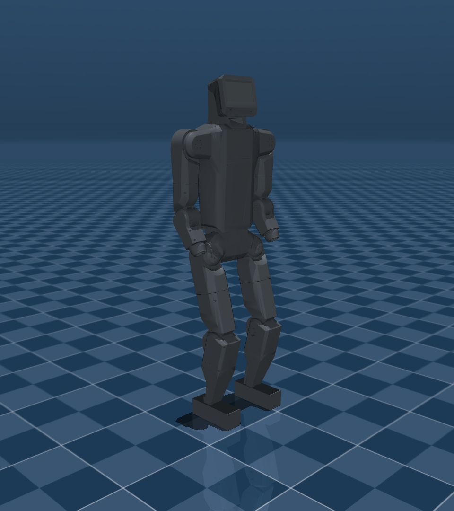
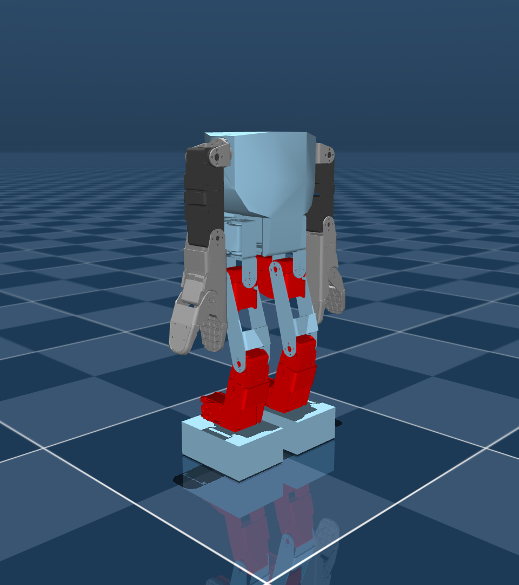
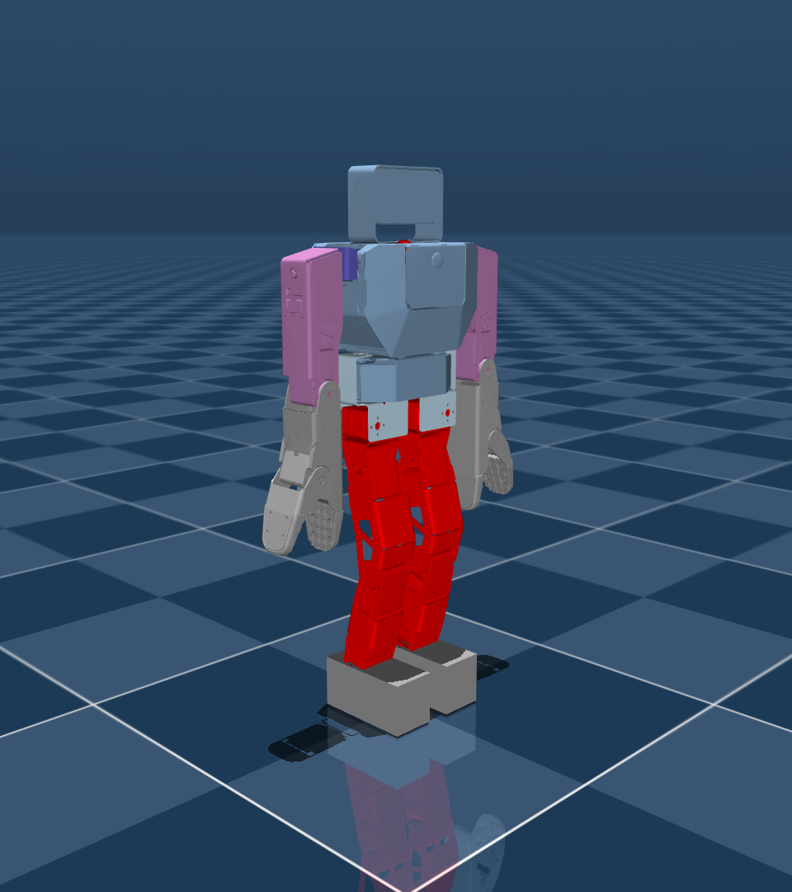
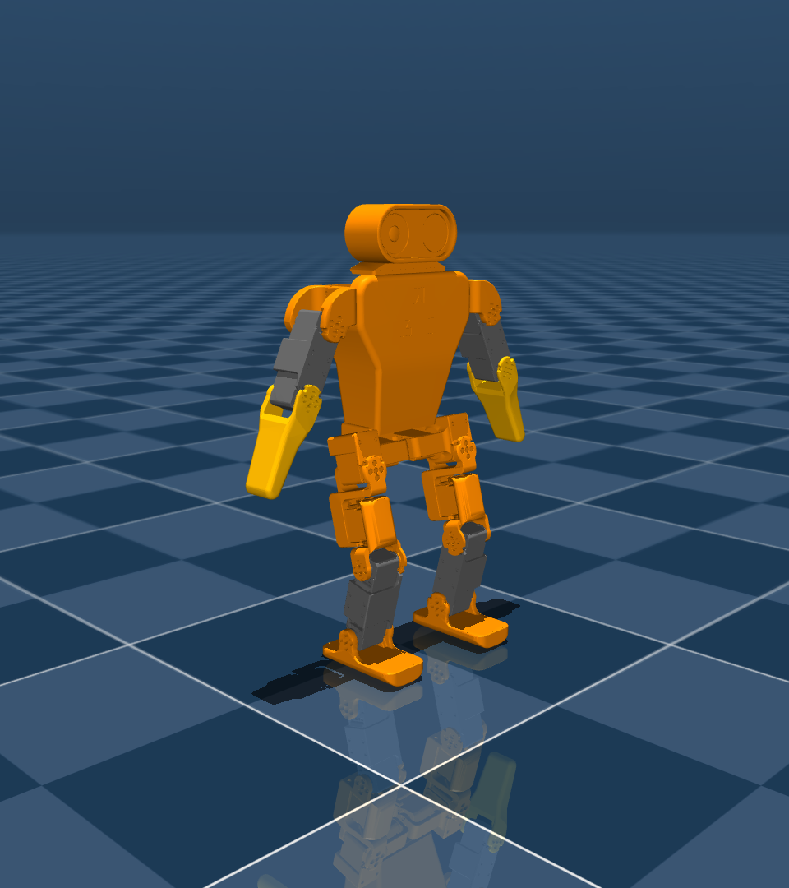
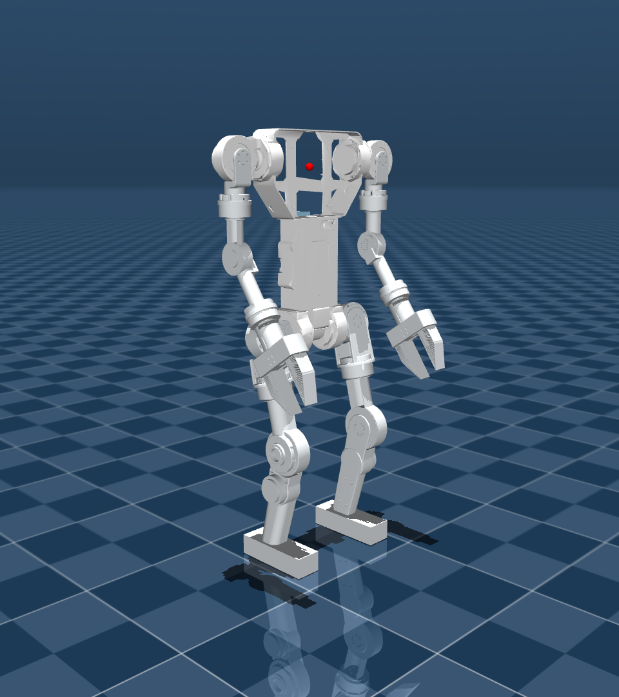

# Chris's robots

MuJoCo models of the humanoids I've built, each with a small walking policy trained
with [mjlab](https://github.com/mujocolab/mjlab) (MuJoCo Warp + PPO). The goal is
not sim-to-real: it's a lean, good-looking walk that can run in a browser
(mujoco-wasm + onnxruntime-web) on my portfolio.

| Robot | | DoF | Mass | Height | Policy |
|---|---|---|---|---|---|
| **K-Bot V2** (`kbot`) |  | 20 | 36 kg | 1.4 m | [`policies/kbot`](policies/kbot) |
| **Z-Bot V3** (`zbot_v3`) |  | 20 | 3.3 kg | 0.40 m | [`policies/zbot_v3`](policies/zbot_v3) (early checkpoint) |
| **Z-Bot V2** (`zbot_v2`) |  | 18 | 3.8 kg | 0.48 m | training |
| **Opus** (`opus`) |  | 16 | 2.8 kg | 0.32 m | [`policies/opus`](policies/opus) (early checkpoint) |
| **GPR / Stompy** (`gpr`) |  | 20 | 29 kg | 1.4 m | training |

K-Bot V2 and GPR are full-size Robstride-actuated humanoids from my time at K-Scale;
the Z-Bots are the 2-ft Feetech-servo robots; Opus is the 3D-printed plastic one.
The GPR physics model is the K-Bot V1 skeleton (same mechanism); its head and shells
are a visual overlay still to be added.

## Layout

```
robots/<name>/          MJCF model (<name>.xml), standalone scene.xml, meshes, robot.json
src/chris_robots/
  robots/<name>.py      actuator gains, posture tolerances, speed ranges per robot
  env_cfgs.py           mjlab velocity task config, scaled by robot size
  rl_cfg.py             PPO config (+ -Sym variants with mirror augmentation)
  mdp.py                gait clock, schedule/swing/flat-foot/arm/torso-sway rewards
  symmetry.py           left/right mirror map for rsl-rl's Symmetry extension
  amp.py                adversarial motion prior (discriminator reward) for the -Amp variants
  tools/                import-robots, render-robots, smoke-test, eval-video, export-web, curves, mocap
data/mocap/             (gitignored) downloaded mocap + retargeted per-robot feature files
policies/<name>/        exported bundle: scene.xml + assets + policy.onnx + policy.json + preview
media/                  renders
```

## Setup

Needs Python 3.12, [uv](https://docs.astral.sh/uv/) and an NVIDIA GPU (trained on an
RTX 5070 Ti; the lockfile pins CUDA 13 wheels for torch/warp).

```sh
uv sync
MJLAB_WARP_QUIET=1 uv run smoke-test kbot          # builds the env, steps it, prints stats
uv run list-envs | grep Chris                       # Chris-Velocity-Flat-<Robot>
```

## Train / play / export

```sh
uv run train Chris-Velocity-Flat-Kbot-Sym --env.scene.num-envs 4096 --agent.run-name v1
uv run curves kbot                                  # training curves as a table
MUJOCO_GL=egl uv run eval-video kbot                # mp4 + contact sheet + gait analysis per checkpoint
uv run play Chris-Velocity-Flat-Kbot                # interactive viewer (latest checkpoint)
MUJOCO_GL=egl uv run export-web kbot --preview      # policies/kbot/, verified with plain mujoco + onnxruntime
```

A 5000-iteration run (4096 envs, 24 steps each) takes ~40 min on the 5070 Ti; the
runner exports an ONNX policy with every checkpoint.

## Policy bundle format

`export-web` produces a folder that only needs MuJoCo and an ONNX runtime, no mjlab:

* `scene.xml`: floor, lights, robot, one `<position>` actuator per policy action (in
  action order, with the trained kp/kd), and an `init_state` keyframe.
* `policy.onnx`: actor MLP with its observation normalizer baked in. `obs[1, N] -> actions[1, A]`.
* `policy.json`: everything needed to build the observation vector and apply actions:
  observation layout (`base_lin_vel`, `base_ang_vel`, `projected_gravity`,
  `joint_pos - default`, `joint_vel`, `last_action`, `command`, `gait_clock`), joint order
  and qpos/qvel addresses, default pose, gains, action scale, sim timestep (0.005 s,
  4 substeps per 50 Hz policy step), command ranges and the gait-clock parameters.

The `gait_clock` observation is `[sin 2πφ, cos 2πφ]` of a phase φ the runtime advances
itself: `φ += dt / period` whenever the commanded speed is above
`gait_clock.standing_threshold`, where `period` interpolates linearly from
`period_walk` at `walk_vel` to `period_run` at `run_vel` (speed = |v_xy| + 0.3 |ω_z|).
The clock is what gives the gait its rhythm; the policy was trained with left-foot
stance at φ ∈ [0, duty) and right-foot stance half a cycle later.

`chris_robots.tools.export_web.BundleRunner` is a ~80-line reference implementation of
the runtime (including the clock); `export-web` runs it after every export to make sure
the bundle walks.

## Gait design

The gaits are plain PPO (rsl-rl) on mjlab's velocity task, with the default reward set
replaced by a small "animated character" set, see `src/chris_robots/env_cfgs.py`:

* **Phase clock** (Siekmann et al. 2021): a `gait_clock` command term drives a periodic
  contact schedule reward (each foot in contact when its phase says stance) and a
  bell-shaped swing-height target. Walking is 60 % stance; running is 40 % with a
  flight phase. Period scales with commanded speed.
* **Posture**: loose per-joint tolerances on hip/knee/shoulder pitch (big strides, big arm
  swing), tight tolerances on the lateral axes (hip roll/yaw, shoulder roll/yaw, wrists),
  plus a forward torso lean that grows with speed.
* **Arm swing**: contralateral shoulder pitch follows the opposite hip; pitch-type elbows
  flex on the forward swing. A lateral-deviation penalty keeps the arms moving
  front/back rather than flapping.
* **Feet**: stance-sole tilt penalty (beyond 3°) and foot-slip penalty; no air-time or
  stride rewards (those were exploited as "hover one foot and skate on the other").
  A `feet_apart` penalty stops the "catwalk" (feet on one line, clipping through each
  other): lateral foot separation in the base frame must stay above ~80 % of the
  standing hip width.
* **Torso**: no "stay level" terms. Instead the clock drives a human-like animation layer
  with amplitudes taken from gait-lab kinematics and exaggerated for readability: torso
  roll toward the stance leg (pelvic list, ~9°), pelvic yaw rotation (~10°, added to the
  commanded yaw rate) and a vertical bob at twice the stride frequency (~5 % of height,
  lowest at double support). The forward lean still grows with speed.
* **Variety**: the clock period is randomised ±10 % per episode, so the runtime can vary
  the gait rate (`policy.json: gait_clock.period_scale_range`).
* **Soft servos**: the Feetech-driven robots (Z-Bot V2/V3, Opus) use a deliberately
  under-powered hobby-servo model: PD gains for a 5 Hz / ζ 0.6 closed loop (vs 10 Hz /
  ζ 2 on the K-Bot), 3 N·m legs, 1 N·m arms and a stronger action-rate penalty, so the
  motion is compliant and bouncy rather than snapped into place.
* **Symmetry**: the `-Sym` task variants add rsl-rl's mirror data augmentation and mirror
  loss. The left/right mapping is derived from the MuJoCo joint axes
  (`src/chris_robots/symmetry.py`) and checked against physically mirrored states.

`uv run eval-video <robot>` renders a scripted stand / walk / turn / sidestep / jog / sprint
sequence for a few checkpoints and prints a gait analysis per segment (steps, duty,
alternation, stride, swing height, mid-stance sole tilt, corner contacts, period,
left/right symmetry, arm swing amplitudes, torso roll/yaw sway, bob, step width, joint
"sharpness") with a WALK / GLITCH / FELL verdict, plus a gait diagram (`*_gait.png`).
This is how the policies above were judged.

### Motion prior from mocap (`-Amp` variants)

The hand-made animation layer above is one way to get a human-looking gait. The
`Chris-Velocity-Flat-<Robot>-Amp` tasks replace it (clock, posture prior, lean, arm swing,
sway, bob) with an Adversarial Motion Prior (Peng et al. 2021): a discriminator is
trained online to tell retargeted human motion-capture transitions from the policy's,
and its output is the style reward alongside velocity tracking.

```sh
MUJOCO_GL=egl uv run mocap kbot --render     # download + retarget, data/mocap/kbot.npz, media/mocap/*
uv run train Chris-Velocity-Flat-Kbot-Amp --env.scene.num-envs 4096 --agent.run-name v1_amp
```

Reference motion is Ubisoft's LAFAN1 (walk/run/sprint clips) as retargeted to the
Unitree G1 by Unitree (`lvhaidong/LAFAN1_Retargeting_Dataset`, CC BY-NC-ND 4.0, so it is
downloaded on demand and not stored here). `mocap.py` maps G1 joints onto ours by role
(`left hip pitch` ...), fixing axis sign and rest-pose offset from the two MJCFs, scales
lengths by leg length and time by its square root, and writes the AMP features
(joint pos/vel, root velocity, gravity, height, foot positions in the base frame).
The discriminator (`amp.py`) lives inside a reward term and refits itself every rollout,
so the standard mjlab `train`/`play`/`eval-video`/`export-web` tooling is unchanged;
runs named `*_amp*` are evaluated with the AMP observation layout (no gait clock).
There is also a `-SymAmp` variant that keeps the clock layer and adds the prior as a
low-weight style nudge.

Status: experimental. With a first pass of tuning (velocity-free features, 0.1 s
transitions, gradient penalty 10) the pure `-Amp` K-Bot learns to stand, track
commands and sprint with 1.2 m strides and bent "runner" elbows within 1000
iterations, but its walk is a quick 0.3 m shuffle with no torso motion; the
discriminator either wins outright on sim/mocap mismatch or is fooled by a shuffle
plus arm flailing. The clock-based layer is what the published bundles use.

## Modelling notes

* Models come from the K-Scale URDF/MJCF exports via `import-robots`, which strips
  actuators/sensors, renames the root to `base`, keeps only the sole boxes as collision
  geometry, adds mjlab's IMU sensors and foot sites, and derives a knees-bent standing
  pose from the joint axes.
* PD gains follow mjlab's G1 recipe (`kp = armature * (2*pi*10)^2`, `zeta = 2`), with
  action scale ~0.25 rad.
* Not sim-to-real, so a few motors are stronger than the real ones where the real
  limits make a 36 kg robot unable to balance (K-Bot/GPR ankle and hip roll); see the
  comments in `robots/kbot.py`.
